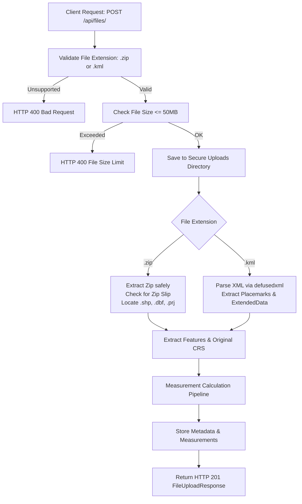
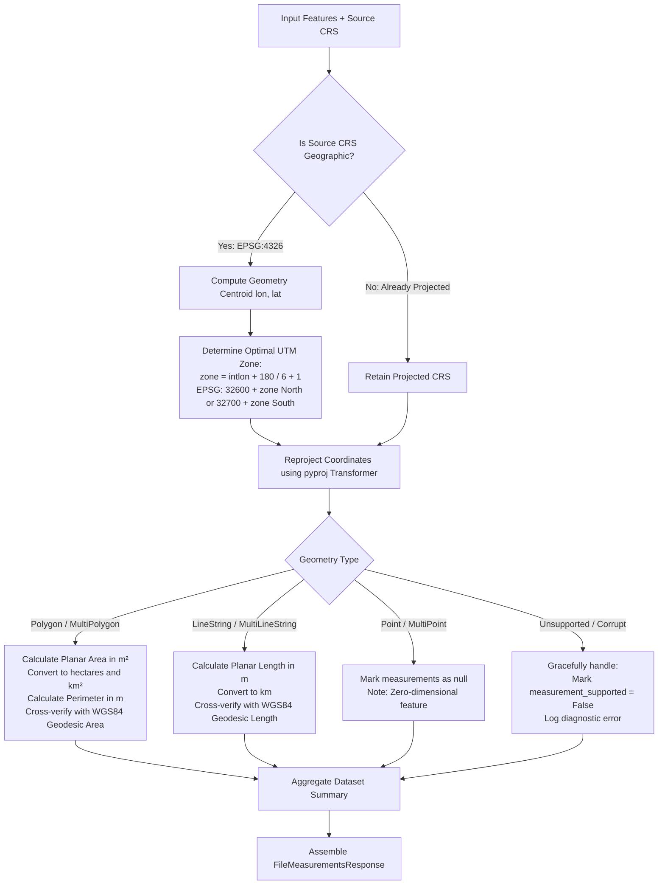

# 🌐 Geospatial File Measurement API

A production-grade backend service built with **FastAPI**, **Shapely**, and **PyProj** that accepts geospatial files (**ESRI Shapefile `.zip`** and **OGC KML `.kml`**), parses and extracts geographic features, reprojects coordinates to minimum-distortion projected Coordinate Reference Systems (UTM), and calculates high-precision geometric measurements (polygon area and linestring length).

Includes an interactive **Swagger/OpenAPI** interface and a **Studio Dashboard** with dark-mode glassmorphic aesthetics and live **Leaflet.js** map visualization.

---

## 📑 Table of Contents

- [Key Features](#-key-features)
- [Architecture & Processing Flow](#-architecture--processing-flow)
  - [Application Structure](#application-structure)
  - [File-Processing Flow](#file-processing-flow)
  - [Measurement Calculation Flow](#measurement-calculation-flow)
  - [CRS Handling Strategy](#crs-handling-strategy)
- [API Reference & Examples](#-api-reference--examples)
  - [1. Upload & Process File (`POST /api/files/`)](#1-upload--process-file-post-apifiles)
  - [2. Get File Information (`GET /api/files/{id}/`)](#2-get-file-information-get-apifilesid)
  - [3. Get Feature Measurements (`GET /api/files/{id}/measurements/`)](#3-get-feature-measurements-get-apifilesidmeasurements)
  - [4. Get GeoJSON FeatureCollection (`GET /api/files/{id}/geojson/`)](#4-get-geojson-featurecollection-get-apifilesidgeojson)
  - [5. List Uploaded Files (`GET /api/files/`)](#5-list-uploaded-files-get-apifiles)
  - [6. Delete File Record (`DELETE /api/files/{id}/`)](#6-delete-file-record-delete-apifilesid)
  - [7. Service Health Check (`GET /api/health`)](#7-service-health-check-get-apihealth)
- [Local Setup & Installation](#-local-setup--installation)
  - [Option A: Python Virtual Environment](#option-a-python-virtual-environment)
  - [Option B: Docker & Docker Compose](#option-b-docker--docker-compose)
- [Running the Test Suite](#-running-the-test-suite)
- [Design Decisions & Alternatives](#-design-decisions--alternatives)
- [Learnings & Future Scope](#-learnings--future-scope)

---

## 🌟 Key Features

- **Multi-Format Support**:
  - **ESRI Shapefile**: Zipped archives (`.zip`) containing `.shp`, `.shx`, `.dbf`, and optional `.prj`. Safely unzips with directory traversal protection (Zip Slip prevention).
  - **OGC KML**: XML files (`.kml`) supporting `Polygon` (with outer and inner boundary rings / holes), `LineString`, `Point`, `MultiGeometry`, and `ExtendedData` (name, description, schema attributes).
- **Rigorous CRS Transformation**:
  - Automatically classifies input CRS (geographic vs. projected).
  - Geographic coordinates (`EPSG:4326`) are never measured in raw degrees.
  - Dynamically computes the optimal **Universal Transverse Mercator (UTM)** zone based on feature centroid coordinates for minimum conformal scale distortion (< 0.1%).
  - Performs cross-verification against the **WGS84 ellipsoid** using Karney's geodesic inverse algorithm (`pyproj.Geod`).
- **Graceful Geometry Handling**:
  - `Polygon` / `MultiPolygon`: Area in square meters ($m^2$), hectares ($ha$), square kilometers ($km^2$), and perimeter ($m$).
  - `LineString` / `MultiLineString`: Length in meters ($m$) and kilometers ($km$).
  - `Point` / `MultiPoint`: Handled gracefully (zero-dimensional, measurements marked `null` with explicit diagnostics).
  - `GeometryCollection` / Invalid / Empty Geometries: Handled gracefully without crashing, logging diagnostic notes.
- **Interactive Studio UI**:
  - Drag-and-drop file uploader with real-time feedback.
  - Interactive dark-mode map powered by **Leaflet.js** rendering feature boundaries, paths, and points.
  - Dynamic metrics summary and feature data table with search and filtering.
  - Built-in one-click sample file loaders.

---

## 🏗 Architecture & Processing Flow

### Application Structure

```
geospatial_measurement_api/
├── app/
│   ├── __init__.py
│   ├── main.py                     # FastAPI application setup, CORS, lifespan, routes
│   ├── api/
│   │   ├── __init__.py
│   │   ├── files.py                # File upload, info, measurements, geojson endpoints
│   │   ├── health.py               # Health check endpoint
│   │   └── samples.py              # Sample data download endpoints
│   ├── core/
│   │   ├── __init__.py
│   │   ├── config.py               # Configuration settings and limits
│   │   ├── logging.py              # Structured application logger
│   │   └── exceptions.py           # Domain-specific exception hierarchy
│   ├── models/
│   │   ├── __init__.py
│   │   ├── file_models.py          # Pydantic schemas for file upload & status
│   │   └── measurement_models.py   # Pydantic schemas for measurements & summaries
│   ├── services/
│   │   ├── __init__.py
│   │   ├── crs_service.py          # CRS parsing, UTM zone calculation, reprojection
│   │   ├── shapefile_parser.py     # Safe zip extraction, PyShp reader, DBF sanitizer
│   │   ├── kml_parser.py           # Secure XML parser for KML Placemarks & Geometries
│   │   ├── measurement_service.py  # Area/length calculations & geodesic verification
│   │   ├── file_processor.py       # Orchestration pipeline
│   │   └── storage_service.py      # Thread-safe in-memory & metadata repository
│   └── static/
│       ├── index.html              # Modern dark-mode Studio dashboard
│       ├── css/style.css           # Glassmorphic CSS design system
│       └── js/app.js               # Leaflet map, API client, search & UI controllers
├── samples/                        # Pre-generated sample datasets
│   ├── california_survey.zip       # Zipped Shapefile with polygons & attributes
│   └── san_francisco_park.kml      # KML with Polygon, LineString, and Point
├── tests/
│   ├── __init__.py
│   ├── conftest.py                 # Pytest fixtures and test client
│   ├── test_api_files.py           # Integration tests for all REST endpoints
│   ├── test_crs_service.py         # Unit tests for CRS classification & UTM zones
│   ├── test_shapefile_parser.py    # Unit tests for zip extraction & shapefile parsing
│   ├── test_kml_parser.py          # Unit tests for KML XML parsing & edge cases
│   └── test_measurement_service.py # Unit tests for area/length measurement logic
├── Dockerfile                      # Production container image
├── docker-compose.yml              # Single-command Docker Compose setup
├── requirements.txt                # Python dependencies
├── generate_samples.py             # Script to regenerate sample datasets
└── README.md                       # Comprehensive documentation
```

---

### File-Processing Flow



---

### Measurement Calculation Flow



---

### CRS Handling Strategy

Geographic coordinates (such as WGS 84, `EPSG:4326`) express positions on the Earth's curved ellipsoidal surface in angular units (**degrees of longitude and latitude**).
Calculating area directly from degree coordinates ($deg^2$) or length in degrees ($deg$) produces physically meaningless results because:
1. $1^\circ$ of longitude equals $\approx 111.32\text{ km}$ at the equator, but shrinks to $\approx 78.85\text{ km}$ at $45^\circ\text{ latitude}$, and approaches $0\text{ km}$ at the poles.
2. Distortion scales quadratically for area calculations.

#### Our Strategy:
1. **Source CRS Identification**:
   - For **Shapefiles**, the projection is read from the companion `.prj` file using `pyproj.CRS.from_user_input()`. If missing or unspecified, coordinate bounds are evaluated; if within $[-180, 180]$ and $[-90, 90]$, it defaults to `EPSG:4326`.
   - For **KML**, the OGC specification standardizes all coordinates to WGS 84 (`EPSG:4326`).
2. **Optimal Conformal Projection Selection (Auto-UTM)**:
   - For geographic datasets, each feature's centroid longitude and latitude are evaluated.
   - The Earth is divided into 60 longitudinal UTM zones of $6^\circ$ width:
     $$\text{zone} = \left\lfloor \frac{\text{longitude} + 180}{6} \right\rfloor + 1$$
   - The projected EPSG code is chosen dynamically:
     - Northern hemisphere ($\text{latitude} \ge 0^\circ$): `EPSG:32600 + zone`
     - Southern hemisphere ($\text{latitude} < 0^\circ$): `EPSG:32700 + zone`
   - UTM projections are conformal (angle-preserving) and keep scale distortion strictly below **0.1%** across the entire zone.
3. **Coordinate Transformation**:
   - `pyproj.Transformer.from_crs(source_crs, target_crs, always_xy=True)` is combined with `shapely.transform` to reproject both 2D $(x, y)$ and 3D $(x, y, z)$ coordinates into metric space.
4. **WGS 84 Geodesic Cross-Verification**:
   - For total transparency, ellipsoidal geodesic area and perimeter are computed using Karney's geodesic inverse algorithm on the WGS 84 ellipsoid via `pyproj.Geod(ellps="WGS84")`. Both the projected planar measurements and geodesic values are reported in the response.

---

## 📡 API Reference & Examples

### 1. Upload & Process File (`POST /api/files/`)
Uploads a `.zip` (Shapefile) or `.kml` file and processes it immediately.

**Request:**
```bash
curl -X POST "http://localhost:8000/api/files/" \
  -F "file=@samples/san_francisco_park.kml"
```

**Response (`201 Created`):**
```json
{
  "id": "01baec37-ba60-4dd0-8af0-499a6e3bb69f",
  "filename": "san_francisco_park.kml",
  "file_type": "KML",
  "feature_count": 3,
  "crs": "EPSG:4326",
  "status": "COMPLETED",
  "uploaded_at": "2026-10-09T07:58:21.352779+00:00",
  "message": "File 'san_francisco_park.kml' processed successfully with 3 features."
}
```

---

### 2. Get File Information (`GET /api/files/{id}/`)
Returns summary metadata for the uploaded file.

**Request:**
```bash
curl -s "http://localhost:8000/api/files/01baec37-ba60-4dd0-8af0-499a6e3bb69f/"
```

**Response (`200 OK`):**
```json
{
  "id": "01baec37-ba60-4dd0-8af0-499a6e3bb69f",
  "filename": "san_francisco_park.kml",
  "file_type": "KML",
  "feature_count": 3,
  "crs": "EPSG:4326",
  "status": "COMPLETED",
  "uploaded_at": "2026-10-09T07:58:21.352779+00:00",
  "processed_at": "2026-10-09T07:58:21.355746+00:00",
  "file_size_bytes": 1532,
  "error": null
}
```

---

### 3. Get Feature Measurements (`GET /api/files/{id}/measurements/`)
Returns calculated measurements for all features, summary metrics, and projection diagnostics.

**Request:**
```bash
curl -s "http://localhost:8000/api/files/01baec37-ba60-4dd0-8af0-499a6e3bb69f/measurements/"
```

**Response (`200 OK`):**
```json
{
  "file_id": "01baec37-ba60-4dd0-8af0-499a6e3bb69f",
  "filename": "san_francisco_park.kml",
  "crs_original": "EPSG:4326",
  "crs_projected_strategy": "Feature Centroid-based UTM Zone Selection (minimum distortion) with WGS84 Geodesic Ellipsoidal Cross-Verification",
  "summary": {
    "total_features": 3,
    "polygon_count": 1,
    "linestring_count": 1,
    "point_count": 1,
    "unsupported_count": 0,
    "total_area_sq_m": 312708.78,
    "total_area_hectares": 31.2709,
    "total_area_sq_km": 0.312709,
    "total_length_m": 1070.62,
    "total_length_km": 1.0706
  },
  "measurements": [
    {
      "feature_id": "0",
      "name": "Golden Gate Park Meadow",
      "geometry_type": "Polygon",
      "original_crs": "EPSG:4326",
      "projected_crs": "EPSG:32610 (UTM Zone 10N)",
      "area_sq_m": 312708.78,
      "area_hectares": 31.2709,
      "area_sq_km": 0.312709,
      "perimeter_m": 2296.83,
      "length_m": null,
      "length_km": null,
      "geodesic_area_sq_m": 312943.05,
      "geodesic_length_m": null,
      "geometry": {
        "type": "Polygon",
        "coordinates": [
          [[-122.486, 37.769], [-122.478, 37.769], [-122.478, 37.765], [-122.486, 37.765], [-122.486, 37.769]]
        ]
      },
      "properties": {
        "name": "Golden Gate Park Meadow",
        "description": "Spacious recreation lawn",
        "zone_code": "REC-01",
        "surface": "Grass",
        "capacity": "5000"
      },
      "measurement_supported": true,
      "notes": "Measured via conformal projected UTM CRS and verified against WGS84 ellipsoid."
    },
    {
      "feature_id": "1",
      "name": "Panhandle Multi-use Trail",
      "geometry_type": "LineString",
      "original_crs": "EPSG:4326",
      "projected_crs": "EPSG:32610 (UTM Zone 10N)",
      "area_sq_m": null,
      "area_hectares": null,
      "area_sq_km": null,
      "perimeter_m": null,
      "length_m": 1070.62,
      "length_km": 1.0706,
      "geodesic_area_sq_m": null,
      "geodesic_length_m": 1071.01,
      "geometry": {
        "type": "LineString",
        "coordinates": [
          [-122.455, 37.772], [-122.448, 37.772], [-122.443, 37.771]
        ]
      },
      "properties": {
        "name": "Panhandle Multi-use Trail",
        "description": "Paved pedestrian and bike trail",
        "surface": "Asphalt",
        "lighting": "Yes"
      },
      "measurement_supported": true,
      "notes": "Length measured via conformal projected UTM CRS."
    },
    {
      "feature_id": "2",
      "name": "Conservatory of Flowers",
      "geometry_type": "Point",
      "original_crs": "EPSG:4326",
      "projected_crs": "EPSG:32610 (UTM Zone 10N)",
      "area_sq_m": null,
      "area_hectares": null,
      "area_sq_km": null,
      "perimeter_m": null,
      "length_m": null,
      "length_km": null,
      "geodesic_area_sq_m": null,
      "geodesic_length_m": null,
      "geometry": {
        "type": "Point",
        "coordinates": [-122.46, 37.772]
      },
      "properties": {
        "name": "Conservatory of Flowers",
        "description": "Victorian greenhouse historic site"
      },
      "measurement_supported": true,
      "notes": "Point features have zero-dimensional length and area. No measurement required."
    }
  ]
}
```

---

### 4. Get GeoJSON FeatureCollection (`GET /api/files/{id}/geojson/`)
Returns a standard RFC 7946 GeoJSON `FeatureCollection` for GIS clients (QGIS, ArcGIS, MapLibre, Leaflet).

**Request:**
```bash
curl -s "http://localhost:8000/api/files/01baec37-ba60-4dd0-8af0-499a6e3bb69f/geojson/"
```

---

### 5. List Uploaded Files (`GET /api/files/`)
Lists all files stored in the system.

**Request:**
```bash
curl -s "http://localhost:8000/api/files/"
```

---

### 6. Delete File Record (`DELETE /api/files/{id}/`)
Removes an uploaded file record and its computed measurements.

**Request:**
```bash
curl -X DELETE "http://localhost:8000/api/files/01baec37-ba60-4dd0-8af0-499a6e3bb69f/"
```

---

### 7. Service Health Check (`GET /api/health`)
Returns operational readiness, version, and server limits.

**Request:**
```bash
curl -s "http://localhost:8000/api/health"
```

---

## 💻 Local Setup & Installation

### Option A: Python Virtual Environment

#### Prerequisites
- Python 3.10+ (Tested on Python 3.11, 3.12, 3.13)
- `pip`

#### 1. Clone Repository & Navigate
```bash
git clone https://github.com/Boggavarapupraveen/geospatial-file-measurement-api.git
cd geospatial-file-measurement-api
```

#### 2. Create and Activate Virtual Environment
On Linux / macOS:
```bash
python3 -m venv .venv
source .venv/bin/activate
```
On Windows:
```powershell
python -m venv .venv
.venv\Scripts\activate
```

#### 3. Install Dependencies
```bash
pip install -r requirements.txt
```

#### 4. Run Development Server
```bash
uvicorn app.main:app --host 0.0.0.0 --port 8000 --reload
```

The service is now accessible at:
- **Studio Dashboard**: [http://localhost:8000](http://localhost:8000)
- **Interactive Swagger Docs**: [http://localhost:8000/docs](http://localhost:8000/docs)
- **ReDoc Documentation**: [http://localhost:8000/redoc](http://localhost:8000/redoc)

---

### Option B: Docker & Docker Compose

#### Prerequisites
- Docker Engine & Docker Compose

#### Run with a Single Command:
```bash
docker compose up --build
```
To run in background mode:
```bash
docker compose up -d
```
Access the application at `http://localhost:8000`.

---

## 🧪 Running the Test Suite

The test suite covers unit and integration tests across CRS handling, Shapefile parsing, KML parsing, geometry measurements, and all API endpoints.

```bash
# Run pytest with summary
pytest -v

# Run with coverage report
pytest --cov=app tests/
```

Test coverage includes:
- Valid Shapefile (`.zip`) and KML (`.kml`) ingestion
- Centroid-based UTM projection across Northern and Southern hemispheres
- Deprecated/unsupported geometries handling without crashing
- Rejection of invalid file formats (`.txt`, corrupted zips, malformed XML)
- All REST endpoints: upload, get info, get measurements, get geojson, list, delete, and health check

---

## 🧠 Design Decisions & Alternatives

| Area | Decision Made | Alternative Considered | Rationale |
| :--- | :--- | :--- | :--- |
| **Framework** | **FastAPI** | Django / DRF | FastAPI provides high throughput, native async/sync execution, automatic Pydantic v2 data validation, and out-of-the-box interactive OpenAPI/Swagger docs (`/docs`). For a specialized microservice, FastAPI avoids Django ORM boilerplate. |
| **Geospatial Stack** | **Shapely + PyProj + PyShp + defusedxml** | GDAL / OGR / Fiona / GeoPandas C bindings | The full GDAL C library requires complex native binary dependencies that often fail on minimal Docker images and Windows environments. Pure Python/C-wheel libraries (`Shapely 2.0`, `PyProj`, `PyShp`) provide equivalent high performance with zero C-binding dependency headaches. |
| **CRS Handling** | **Centroid-Based UTM Zone + Geodesic Ellipsoidal Cross-Verification** | Web Mercator (`EPSG:3857`) or Static Albers Equal Area | Web Mercator introduces massive area distortion at higher latitudes (e.g. Greenland appears the size of Africa). UTM preserves conformal local scale (<0.1% distortion) and is standard in engineering. Cross-verification with `pyproj.Geod` guarantees mathematical verification. |
| **KML Parser** | **Safe XML with namespace stripping via `defusedxml`** | `fastkml` library alone | Many KML files in the wild contain varied namespace prefixes, schemas, and extended data formats. `defusedxml` guarantees protection against XML entity expansion attacks (Billion Laughs) while reliably extracting all geometry types and attributes. |
| **Storage Layer** | **Thread-safe in-memory registry with UUIDs** | Relational DB (PostgreSQL / PostGIS) | Keeps local setup zero-config (no external database server required to clone and run). Storage service is isolated behind an abstraction layer, allowing easy drop-in replacement with PostgreSQL / S3. |

---

## 🚀 Learnings & Future Scope

### Key Learnings
1. **Coordinate Systems & Distortions**: Handling geospatial data requires deep appreciation of the difference between geographic angular coordinates and projected planar metrics. Directly taking euclidean distance or area on `EPSG:4326` results in severe mathematical errors.
2. **KML Namespace Variations**: KML files produced by Google Earth, QGIS, and Drone mapping software frequently use different namespace versions (`2.1`, `2.2`, `beta`). Designing namespace-agnostic XML traversal ensures consistent feature parsing.
3. **Zip Slip Security**: Extracting user-uploaded zip archives presents path traversal risks. Explicitly validating that extracted file paths reside strictly within the temporary directory prevents directory traversal vulnerabilities.

### Future Scope & Enhancements
- **Multi-Zone Polygons & Equal-Area Projections**: For extremely large continental polygons spanning multiple UTM zones, dynamically switch to an equal-area projection (such as **Equal Earth `EPSG:6933`** or localized **Albers Equal Area**).
- **Asynchronous Task Queue**: For massive files (>100,000 features or >100MB), offload parsing to background workers (Celery / ARQ / Redis) with webhook callbacks or WebSocket status streaming.
- **Additional Format Support**: Extend parser support to **GeoJSON**, **GeoPackage (`.gpkg`)**, and **FlatGeobuf**.
- **PostGIS / Cloud Storage Integration**: Add a pluggable database backend using PostgreSQL with PostGIS and store raw uploads in AWS S3 or Google Cloud Storage.
- **3D Surface Area & Elevation Profiles**: Leverage third coordinate $(z)$ to calculate 3D slope surface area and elevation gain/loss for linestring trails.

---

## 📜 License
MIT License. Created for technical evaluation.
